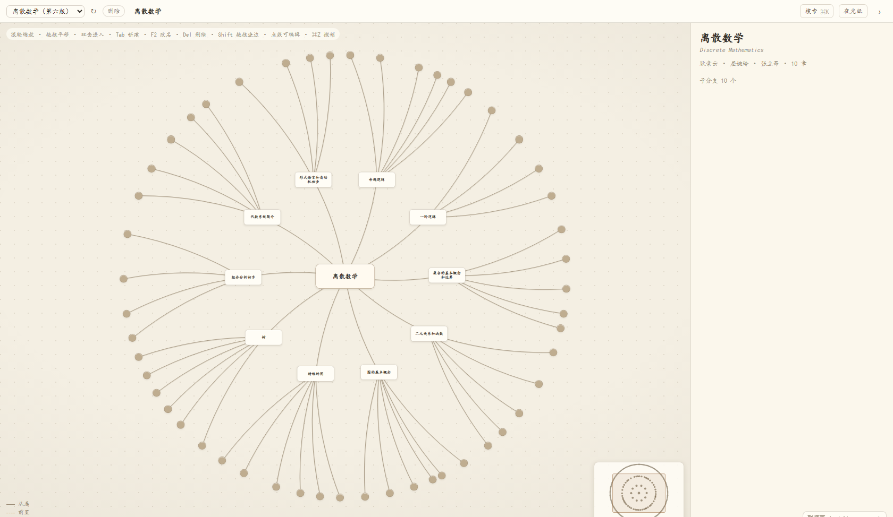
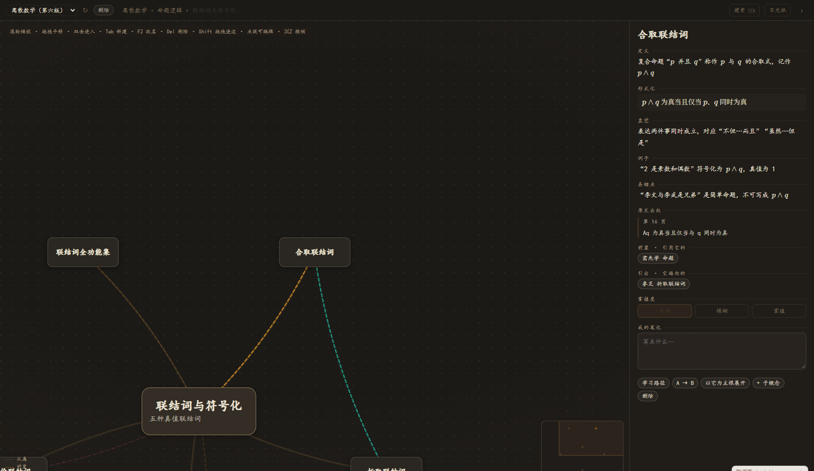
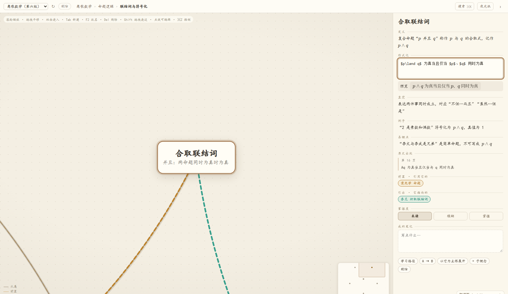
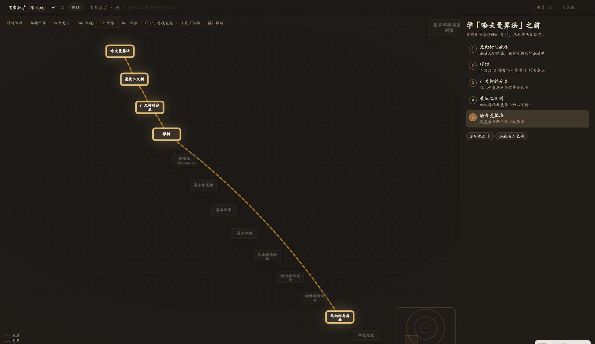
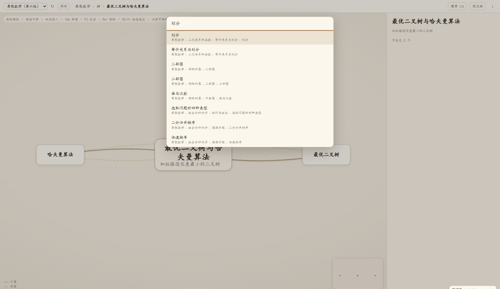
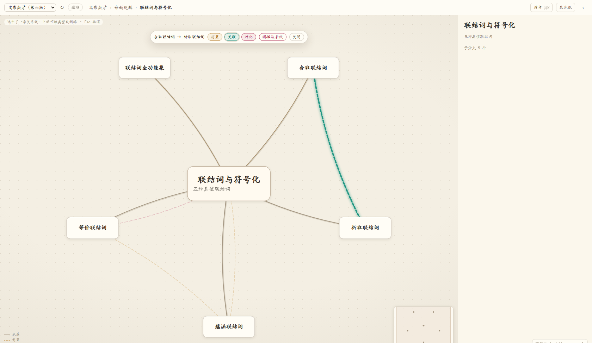

# Synapsis

English · [中文](README.md)

A concept-map plugin for the [DeepSeek Harness](https://github.com/deepseek-ai) web UI.

It spreads the concepts of a book into a map you can walk into. Scroll forward and a sub-branch grows into a map of its own; scroll back and it folds into the layer above. Each concept is a card: definition, formal statement, intuition, examples, pitfalls, plus what it needs first and what it leads to.

## Screenshots



*The overview layer. Ten chapters around the root, with topic dots further out.*



*Select a concept and the card opens on the right. Formulas are typeset with KaTeX; dark mode becomes "night paper".*



*Double-click any field to edit it. The formal field shows the LaTeX source with a live preview underneath.*



*"What do I need before this?" — the hard prerequisites in order, gold-ringed, everything else dimmed.*



*⌘K searches titles, English names, body text and notes.*



*Click a relation line to select it; a small toolbar appears for changing its type or deleting it.*

## Using it

Click "析域" in the sidebar and the panel takes over the main area.

**Scroll to go in.** The wheel zooms around the cursor, and each layer is pinned to a readable size. Push further and you enter the nearest child, which becomes the new root. Zoom back by half and you return one layer up. No new window, and no blurry scaling.

**Every layer looks like its own map.** Changing focus re-lays out the graph as a full circle around the new root, so any sub-branch opens as a complete map rather than a wedge of its parent.

**Cards thin out with distance.** The focused card is full (title, summary, definition), children show title and summary, further out only a title, and beyond that a dot.

**The side panel** has five body fields, the source citation, prerequisites, what it leads to, a mastery marker and a personal note. Empty fields show "click here to write"; double-click starts editing, and the formal field gives you the LaTeX source with a live preview.

**Four kinds of line.** Solid for hierarchy, amber dashes for prerequisites, teal dots for related, rose double lines for contrast.

**Breadcrumbs and a minimap** tell you where you are and how big the whole map is.

**Search** looks at titles, English names, body text and notes. Enter jumps there: the concept centres itself and becomes the new root.

**Editing in place**: `Tab` adds a child, `Enter` adds a sibling, `F2` renames, `Delete` removes. Deleting a node with children asks whether to take the subtree or lift the children up. Changes are written back after 0.6s, and the previous version is kept as `.bak`.

**Linking**: hold `Shift` and drag from one card to another to create a `prereq` edge. Dragging the same pair again turns it into `related`, then `contrast`, then removes it. Dragging the other way round flips the direction and resets it to `prereq`. Parent and child never get a relation edge — the tree already says that.

**Editing an edge**: click the line to select it. It lights up and a toolbar appears with "A → B" and the three types. Changing the type or deleting writes immediately, and `⌘Z` undoes it. `Delete` removes the line, `Esc` or a click on empty space deselects. Hierarchy lines can't be selected; the tree decides those.

**Learning path**: select a concept and click "学习路径" to get its hard prerequisites in order on the right — a topological order when there are no cycles. "A → B" gives the shortest chain from any starting concept. The camera pulls back so the whole chain fits, with the cards on it ringed in gold.

**Two papers**: light is cream paper, dark is night paper, both with a paper grain. The button in the top bar switches in place and remembers your choice; on first install it follows the host's light or dark theme.

**Switching and deleting maps**: the library dropdown sits at the far left of the top bar. Switching reloads and re-frames the map. Delete needs two clicks — the first arms it, four seconds without a second click disarms it. Deleted files aren't destroyed; they move into `.trash/` inside the library folder.

**Starting from nothing**: "+ 新建" next to the dropdown creates an empty map with a single root node. Press `Tab` to add concepts. Use it when you'd rather build the map by hand than generate it.

**Drag a card to re-parent it**: drag one card onto another and it moves under it. Dropping into its own descendants is refused, since that would cut the tree in two. Dragging empty space still pans.

**Export**: the top bar's "导出" gives you a PNG, an SVG, or a Markdown outline. It exports **the layer you're looking at**, not the whole book — go back to the root with the breadcrumb if you want everything. Pick SVG when you need detail: it stays sharp at any zoom. The Markdown outline suits pasting into a notes app.

### Keyboard

| Key | Action |
| --- | --- |
| `⌘K` / `Ctrl+K` | Search |
| Double-click a card | Enter that layer (it becomes the new root) |
| Double-click a side-panel field | Edit that field |
| `Tab` / `Enter` | Add child / add sibling |
| `F2` | Rename |
| `Delete` | Delete node (asks if it has children) or the selected edge |
| Drag a card | Re-parent it |
| `Shift` + drag | Create a relation edge |
| `⌘Z` / `Ctrl+Z` | Undo (consecutive typing collapses into one step) |
| `Esc` | Close search, editing, the delete prompt, the selected edge, the export menu — in that order |

## Install

The repository root is the plugin package: `package.json` carries `dsh.bundle.patch`, and `engines.dsh` declares the supported DSH range. Pick one of the three standard routes, then reload the host page.

**From GitHub (recommended, no build step)**

```sh
dsh plugin --profile desktop add github:Mathilde1214/dsh-synapsis
```

Everything is plain JavaScript and `client.js` is committed alongside the source, so there's no `prepare` script and nothing to approve in pnpm's `allowBuilds`.

**From a tarball (offline, air-gapped)**

```sh
pnpm pack            # run in the repository root; produces dsh-synapsis-<version>.tgz
dsh plugin --profile desktop add ./dsh-synapsis-<version>.tgz
```

**From a local directory (when you're changing the code)**

```sh
dsh plugin --profile desktop add /absolute/path/to/this/repo
```

You can also do it from the panel: `plugin_manager: install_bundle` with the directory's absolute path as target.

**Uninstall**

```sh
dsh plugin --profile desktop remove dsh-synapsis
```

**Compatibility**: `engines.dsh` is `>=0.2.0 <0.3.0`. DSH checks it both when installing and when starting a profile, and refuses with an explanation if it doesn't match. To run on a newer DSH, widen that range and reinstall; the panel only uses the `slots` and `webServer` extension points.

**From the plugin index**: the repo ships `plugin-market/index.json` in DSH's custom-index format. Add that URL under "Plugins → Discover → Add index source" and you can browse and install it like an app store listing:

```
https://raw.githubusercontent.com/Mathilde1214/dsh-synapsis/main/plugin-market/index.json
```

## Upgrading won't touch your maps

Maps live in the library folder; the plugin lives in the DSH profile. `dsh plugin add`, `plugin_manager install_bundle`, and uninstall-then-reinstall all only replace the code copy under the profile. The library folder is never involved.

There are two safety nets as well: every save keeps the previous version as `.bak`, and deleting a map moves it into `.trash/` rather than removing it.

So upgrading is just installing the new version. Your maps stay where they are.

## Where the data lives

The first available location wins:

| Priority | Location | Notes |
| --- | --- | --- |
| 1 | `SYNAPSIS_DATA` environment variable | An absolute path; used as-is |
| 2 | `<home>/Synapsis` | Default. `C:\Users\<you>\Synapsis` on Windows, `/Users/<you>/Synapsis` on macOS, `/home/<you>/Synapsis` on Linux |
| 3 | `E:\dsh工作空间\析域` | Legacy path for pre-0.13 installs: used only if it already exists |

The empty state prints the folder in use, so you can select and copy it instead of guessing. It's created on first use. Each map in that folder is a `*.mindmap.json`:

```json
{
  "version": 1,
  "title": "Discrete Mathematics (6th ed.)",
  "nodes": [
    { "id": "ch3-subset", "title": "Subset", "parent": "ch3",
      "summary": "…",
      "definition": "…",
      "formal": "B \\subseteq A \\iff \\forall x(x \\in B \\to x \\in A)",
      "intuition": "…", "examples": "…", "pitfalls": "…",
      "source": { "page": 71, "snippet": "quoted line from the book" },
      "mastery": 0, "note": "" }
  ],
  "edges": [ { "from": "ch1-proposition", "to": "ch1-connect-conj", "type": "prereq" } ]
}
```

`parent` is the hierarchical home (the tree); `edges` are cross-branch relations (the net), with `type` being `prereq`, `related` or `contrast`. Backlinks aren't stored — they're computed on open. Layout isn't stored either; it follows from the focus and the node count.

## Formulas

KaTeX ships with the plugin (`assets/katex/`, fonts included) and is served by the host half at `/synapsis-api/katex/*`. No network, and no dependency on packages the host happens to provide. `$$…$$`, `$…$`, `\(…\)` and `\[…\]` are all recognised; a `formal` value with no delimiters is rendered as a formula too.

## Layout

```
package.json            bundle manifest: dsh.bundle.patch / engines.dsh / dsh.client / files
index.js                host half: library routes (/synapsis-api/list|load|save|delete) + KaTeX assets
client-body.js          panel source (library switching, debounced save, KaTeX readiness)
client.js               build output: core + client-body, this is what gets installed
core/synapsis-core.js   rendering core (layout, camera, LOD, linking, undo), bundled into client.js
assets/katex/           bundled KaTeX js/css/fonts
locale/{zh,en}.json     plugin metadata
cordis.patch.yml        the patch fragment that mounts it into DSH
plugin-market/          plugin index (format 1) for the Discover page
tools/build-plugin.mjs  build: core + client-body → client.js
tools/dev-server.mjs    local dev server (library API + harness page), not shipped in the npm package
tools/dev-panel/        harness page that runs the real client.js in a browser
tools/ocr*.mjs|ps1, extract-images.mjs, merge-chapters.mjs    offline textbook → concept-map pipeline
```

`client.js` is generated — don't edit it by hand. Change `core/synapsis-core.js` or `client-body.js`, then:

```sh
npm run build     # node tools/build-plugin.mjs
npm run dev       # node tools/dev-server.mjs, then open http://127.0.0.1:7788/
```

`files` lists only what's needed at runtime, so `core/` and `tools/` stay out of the npm package; what lands on someone else's machine is the output alone.

## Known limits

- The panel occupies the host's main panel, so it and the conversation view are mutually exclusive — you switch back and forth.
- Relation edges only surface near the focus; otherwise a few hundred nodes turn into yarn. To see a particular relation, go into its chapter first.
- Multi-select isn't implemented yet. Export covers the current layer rather than typesetting the whole book in one go.
- Since the host shows one main panel at a time, you can't watch the map and chat side by side in one window; two browser tabs on the same port works.

## From a textbook to a map

The offline pipeline in this repo turns a scanned textbook into a concept map:

```
PDF → extract-images.mjs   (pull the full-page JPEGs out)
    → ocr.ps1              (Windows OCR, page by page)
    → ocr-join.mjs         (strip spaces, insert page markers)
    → split by chapter → ask a model for one chapter JSON at a time
    → merge-chapters.mjs   (merge into a single *.mindmap.json)
```

Drop the result into the library folder and it shows up in the panel. This works for scans, at the cost of OCR mangling symbols (∧ becomes A, r becomes 厂). Formulas have to be rewritten from domain knowledge, which is why every concept keeps `source.page` and a quoted snippet so you can check it against the book.
