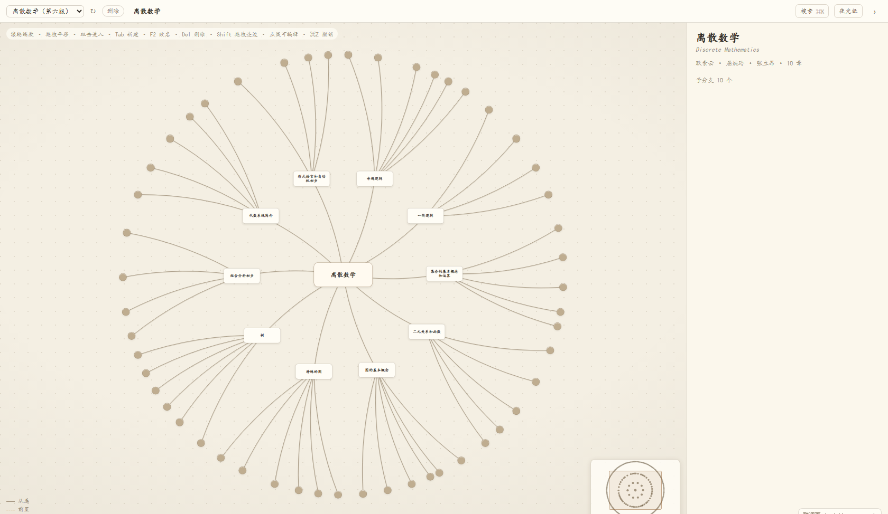
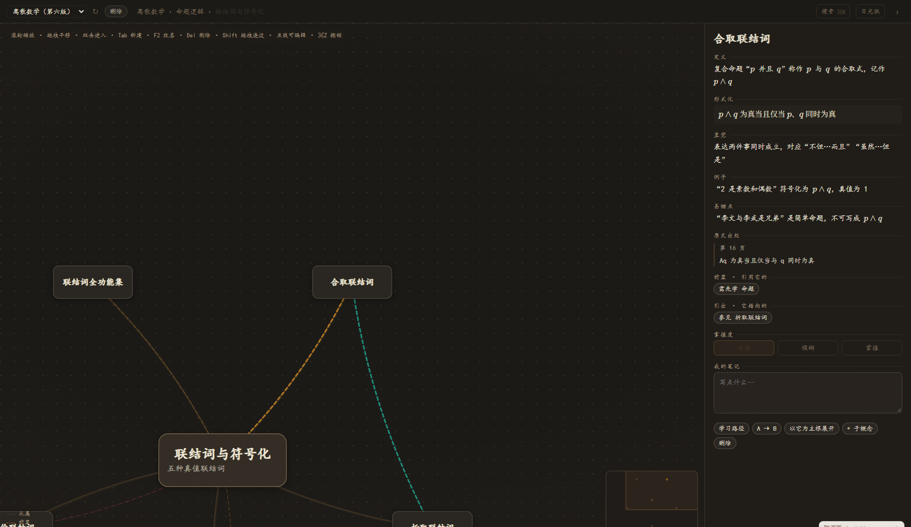
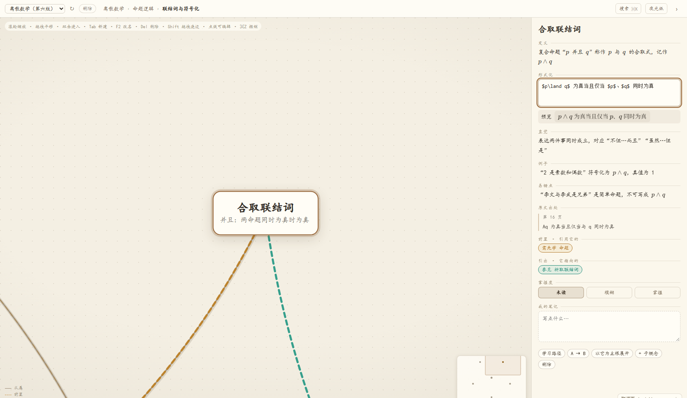
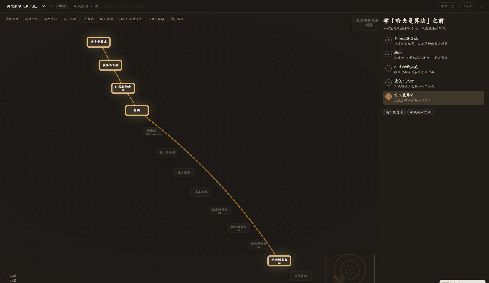
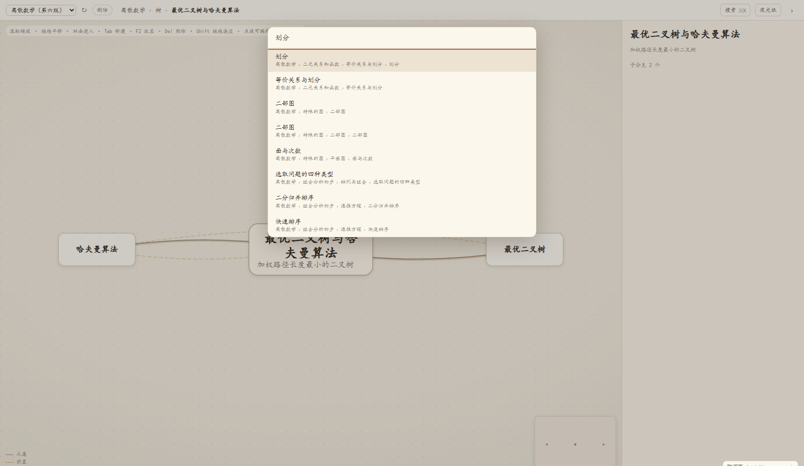
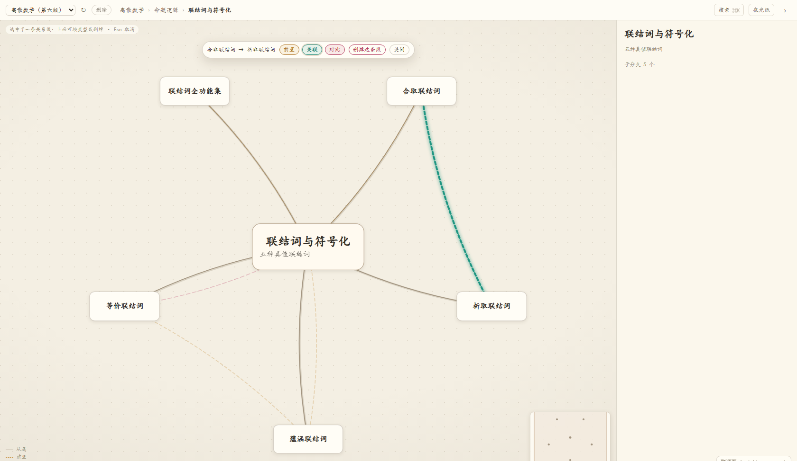

# Synapsis · 析域

[English](README.en.md) · 中文

给 [DeepSeek Harness](https://github.com/deepseek-ai) 桌面端用的概念地图插件（技术上是 DSH 的 web 平台插件，同时适用于桌面版与 `dsh web`）。

它做的事很简单：把一本书的概念摊成一张能走进去的图。滚轮往前推，子分支就长成新的主图；缩回来，又退回原来那一层。每个概念是一张卡，卡上有定义、形式化、直觉、例子、易错点，还有它需要的前置和它引出的东西。

## 效果图



*总览层。十章铺成一圈，再外面是章节里的主题点。*



*点一个概念，右侧展开卡片。公式是 KaTeX 排的，暗色主题下是「夜间纸」。*



*双击任意一栏就能改。形式化那栏给出 LaTeX 源码，下面实时预览。*



*「学它之前要先会什么」——按硬前置排成一条链，链上的卡片描金边，其余让路。*



*⌘K 搜概念名、定义里的词、甚至公式的写法。*



*点一条关系线即可选中，顶部出现换类型和删除的按钮。*

## 怎么用

侧栏点「析域」，整页面板打开一张图。

**滚动即进入。** 滚轮以光标为锚缩放，每一层都被钉在可读的字号上；再往前推，就走进离你最近的子分支，它成为新的主图根。缩小一半退回上一层。不开新窗口，也不会把字糊成像素。

**每层都像一张独立的图。** 换焦点时布局会按它重排成完整圆周，所以任何子分支展开后都是完整的导图，而不是挤在父图某个扇区里。

**卡片按距离分层。** 焦点是全卡（标题、摘要、定义），子级是标题加摘要，再远只留标题，更远收成一个点。

**侧栏概念卡**分五栏正文，加原文出处、前置、引出、掌握度、个人笔记。空栏会显示「点这里写…」，双击就进编辑；形式化那栏编辑时是 LaTeX 源码加实时预览。

**连线分四种。** 从属是实线，前置是琥珀虚线，关联是青绿点线，对比是玫红双线。

**面包屑和小地图**让你知道自己站在哪儿，也知道整张图有多大。

**搜索**按标题、英文名、正文、笔记一起找。回车跳过去，那个概念会正中对齐并成为新的根。

**就地编辑**：`Tab` 加子概念、`Enter` 加同级、`F2` 改名、`Delete` 删除。删一个有子概念的节点时会问：一起删掉，还是只删它、把子概念上提。改完 0.6 秒自动写回文件；切图、新建、删除之前会先把没写完的改动落盘，保存失败就不让你切走。写之前把上一版存进 `.history/`，不是只留一份 `.bak`。

**连边**：按住 `Shift` 从一张卡拖到另一张，松手建一条 `prereq`。同一对概念再拖一次变 `related`，第三次变 `contrast`，第四次把线删掉。反向拖会改方向并重置回 `prereq`。父子之间不建关系边——从属关系已经由树表达了。

**改边、删边**：点那条线就选中，线会亮起来，顶部出现「A → B」和三个类型按钮。换类型或删除立刻落盘，`⌘Z` 能撤销。按 `Delete` 删的是线，按 `Esc` 或点空白取消。从属实线不可选，它由树决定。

**学习路径**：选中一个概念点「学习路径」，右侧按硬前置把「学它之前得先会的」排成有序的链（无环时就是拓扑序）。点「A → B」则给一条从任意起点走到它的最短必经链。打开时整张图会铺开，让整条链都在视野里。

**两套纸**：浅色是米黄纸，暗色是夜间纸，都带纸纹。顶栏那个「日光纸 / 夜光纸」按钮就地切换，会记住你的选择；第一次装好时跟着宿主的明暗走。

**换图和删图**：顶栏最左边是图库下拉，切换就换一张图（会自动重新取景），下次打开面板会回到你上次看的那张。旁边的「删除」要连点两下，第一下只是举枪，4 秒不点就放下。删掉之后底部会出一条提示，6 秒内点「撤销」就能捞回来（文件本来就在库目录的 `.trash/` 里）。

**从空图开始**：下拉左边的「+ 新建」长出一张只有根节点的空白图，按 `Tab` 就能往下加概念。讲义在手上、想自己动手整理的时候用它。

**拖卡片改归属**：直接拖一张卡，松手落在一另一张卡上，它就挂到那张卡下面。拖进自己的子孙里会被拒绝（那样树就断了）。画布空白处拖拽仍然是平移。

**导出**：顶栏「导出」有三样。**PNG 与 SVG 导出你现在看到的这一层**——想导全图就先点面包屑回到根；需要放大看细节就选 SVG，它是矢量的，放多大都清楚。**Markdown 导出的是整棵树**，从根开始写缩进大纲，适合贴进笔记软件。

**大纲视图**：顶栏「大纲」把画布换成一棵树，从整份图的根开始排，跟画布当前停在哪一层无关。点行选中它（右侧照常出概念卡），双击行跳到那一层；左边三角收起分支，右边小圆点是它的掌握度。两百个概念的书，找东西比缩放快。

**复习模式**：顶栏「复习」抽一批概念过一遍——先标题，回想，再翻面看定义、形式化、例子、易错点，然后给自己评「没印象 / 有点模糊 / 会了」。评分直接写回文件的 `mastery`，于是「模糊的」排在下一轮最前面。一轮最多 15 个，只收「写了正文」的概念（只有标题的章、主题不进队列）。选中某一章再点侧栏的「复习这一支」，队列就只从这一支里收；一轮走完如果里面有没印象/模糊的，完成页可以直接「再来一遍刚才模糊的」。卡片可以按住顶部那条拖开，不挡底下的图。

**纸与字**：顶栏「设置」里换纸（米黄 / 灰白 / 淡绿）、换字体（系统 / 楷体 / 宋体 / 黑体，默认「系统」，楷体在 Linux 上常缺字）、字号三档，再用「深浅」那条滑杆把纸整体提亮或压暗一点。夜光纸另有它自己的一套配色，不跟这三套走。选完就记住，下次打开还是这套；「恢复默认」一键回去。

**导入 PDF**：插件自己不解析 PDF，它只认 `.mindmap.json`。真正的活交给 DSH 的对话：顶栏「导入」会告诉你三件事——把 PDF 拖进左边的对话、把哪句话发给它、图会落到哪个库目录（那里有一键复制）。生成完切一下面板（或按 `↻`）就看见了。好处是不用在插件里再配一个模型 key，也不会为同一本讲义重复实现一遍 OCR。

### 快捷键

| 键 | 作用 |
| --- | --- |
| `⌘K` / `Ctrl+K` | 搜索 |
| 双击卡片 | 进入该层（它成为新的根） |
| 双击侧栏正文 | 编辑这一栏 |
| `Tab` / `Enter` | 加子概念 / 加同级概念 |
| `F2` | 改名 |
| `Delete` | 删节点（有子概念会问）或删选中的线 |
| 拖拽卡片 | 改归属（挂到另一张卡下面） |
| `Shift` + 拖拽 | 连一条关系边 |
| `⌘Z` / `Ctrl+Z` | 撤销（连续打字合并成一步） |
| `Esc` | 依次收起搜索、编辑、删除询问、选中的线、导出菜单 |

## 安装

仓库根目录就是插件包：`package.json` 里带 `dsh.bundle.patch`，`engines.dsh` 声明兼容的 DSH 版本。装完刷新宿主页面（桌面端按 `Ctrl/Cmd+R`）。

**先确认 Desktop 的前提**（用桌面版的人最常卡在这一步）：

1. 先把 Desktop 正常启动一次，让它把 profile 初始化好；
2. 完全退出 Desktop（不是关窗口）；
3. 用 Desktop 自带的那份 CLI 装：`<安装目录>/resources/runtime/cli/bin/dsh`（Windows 是 `dsh.cmd`）。用 npm 全局装的 `dsh` 改不到 Desktop 的 profile。

如果不想碰命令行，Desktop 的「插件」页面里也能装，效果一样。

**从 npm 装（发布之后）**

```sh
dsh plugin --profile desktop add dsh-synapsis
```

**怎么更新**

- 用 GitHub 装的：把上面命令里的提交哈希换成新的，重跑一次即可（不钉哈希就是装 main 的最新一版）。
- 用 npm 装的：`dsh plugin --profile desktop add dsh-synapsis@<版本>`，或先 `remove` 再 `add`。
- 用 tarball 装的：重新打包、重新 `add`。
- 更新只替换 `node_modules` 里的插件代码，**库目录里的图一张都不会动**（见下面的「升级不会动你的图」）。
- 更新完刷新宿主页面（桌面端 `Ctrl/Cmd+R`）。

**从 GitHub 装（推荐，不需要任何构建）**

```sh
dsh plugin --profile desktop add github:Mathilde1214/dsh-synapsis#<提交哈希>
```

钉住提交哈希是个好习惯：不钉的话，上游以后推的新代码会在你重装时被静默换上。哈希可以在[提交列表](https://github.com/Mathilde1214/dsh-synapsis/commits/main)里挑一个。

包里是纯 JavaScript，`client.js` 等产物跟仓库一起提交，所以不需要 `prepare` 构建，也不会要求你为它开 pnpm 的 `allowBuilds`。

**从 tarball 装（离线、内网）**

```sh
pnpm pack            # 在仓库根目录执行，得到 dsh-synapsis-<版本>.tgz
dsh plugin --profile desktop add ./dsh-synapsis-<版本>.tgz
```

**从本地目录装（改代码时用）**

```sh
dsh plugin --profile desktop add /绝对路径/到/这个仓库
```

面板里也能装：`plugin_manager: install_bundle`，target 填这个目录的绝对路径。

**卸载**

```sh
dsh plugin --profile desktop remove dsh-synapsis
```

**兼容性**：`engines.dsh` 是 `>=0.2.0 <0.3.0`。DSH 在安装时和启动 profile 时都会校验，不满足会直接拒绝并说明原因。面板只用到 `slots`、`webServer`、`connection`、`tools`、`systemPrompt` 这几个扩展点；DSH 0.3 发布后会实测再放宽这个范围，不需要你自己改包里的字段。

**从插件索引装**：仓库里带了 `plugin-market/index.json`，是 DSH 的自定义插件索引格式。先到「插件 → 实验性插件」里打开 Custom plugin indexes，再到「插件 → 发现 → 添加索引源」填这个地址：

```
https://raw.githubusercontent.com/Mathilde1214/dsh-synapsis/main/plugin-market/index.json
```

## 安全模型

插件只在 `127.0.0.1` 上、通过 DSH 自己的 web server 提供一组 `/synapsis-api/*` 路由，**没有**独立端口，也不对外监听。所有读接口之外的写操作（`/save`、`/create`、`/delete`）都要先过 DSH 的连接校验：不是从 DSH 页面发起的请求会被拒（`401`），而且必须声明 `content-type: application/json`（否则 `415`），请求体上限 8 MB。

`/synapsis-api/katex/*` 是公式排版用的静态资源，保持公开。

所以：不要用 `--host 0.0.0.0` 之类的方式把 DSH 的端口暴露到局域网或公网。真要远程访问，请走带鉴权的反向代理，别把裸端口放出去。

## 升级不会动你的图

图存在库目录里，插件装在 DSH 的 profile 里，两处互不相干。`dsh plugin add`、`plugin_manager install_bundle`、卸载再重装，动的都只是 profile 下那一份代码副本，库目录不会被碰。

另外还有两层兜底：每次真正覆盖前会把上一版存进 `.history/<图名>/latest.json`，另外每 5 分钟留一个时间点快照（最多 40 份）；删图不是真删，而是挪进 `.trash/`。

同一次编辑也不怕撞车：保存带版本号，只有「你看到的那一版」还是磁盘上那一版时才写得进去；别人（或另一个标签页）先改了，会提示冲突，让你选「重新加载（放弃我的改动）」还是「用我这版覆盖」，不会两边互相盖掉。

所以升级的正确姿势就是直接装新版本，图会照旧在那儿。

## 数据放哪

按顺序取第一个可用的位置：

| 优先级 | 位置 | 说明 |
| --- | --- | --- |
| 1 | 环境变量 `SYNAPSIS_DATA` | 填绝对路径就完全按它来 |
| 2 | 插件配置里的 `dataDir` | 写在 `cordis.patch.yml` 的插件条目下，升级不丢 |
| 3 | `<用户主目录>/Synapsis` | 默认值。Windows 是 `C:\Users\<你>\Synapsis`，macOS 是 `/Users/<你>/Synapsis`，Linux 是 `/home/<你>/Synapsis` |

桌面端设置 `SYNAPSIS_DATA` 有个坑：macOS/Linux 上 Desktop 读的是登录 shell 的环境（`~/.zprofile`、`~/.zshrc`），改完要**完全退出再启动**；Windows 要在「系统属性 → 环境变量」里给当前用户加，然后重启 Desktop。不想折腾环境变量就改插件配置里的 `dataDir`。

面板空态里会把实际用的目录印出来，可以直接选中复制，第一次使用会自动创建。第一次装上、库里还没有任何图时，会放一张五个节点的小示例（「示例 · 从这里开始」）——它只讲怎么操作，删掉就不会再生成。目录里每份图是一个 `*.mindmap.json`：

```json
{
  "version": 1,
  "title": "离散数学（第六版）",
  "nodes": [
    { "id": "ch3-subset", "title": "子集", "parent": "ch3",
      "summary": "…",
      "definition": "…",
      "formal": "B \\subseteq A \\iff \\forall x(x \\in B \\to x \\in A)",
      "intuition": "…", "examples": "…", "pitfalls": "…",
      "source": { "page": 71, "snippet": "原文摘句" },
      "mastery": 0, "note": "" }
  ],
  "edges": [ { "from": "ch1-proposition", "to": "ch1-connect-conj", "type": "prereq" } ]
}
```

`parent` 是分类归属（树），`edges` 是跨分支的关系（网），`type` 取 `prereq` / `related` / `contrast`。反链不存，打开时现算；布局也不持久化，由焦点和节点数算出来。

## 公式

插件自带 KaTeX（`assets/katex/`，含字体），由 Host 半边的 `/synapsis-api/katex/*` 路由提供，不依赖网络，也不要求宿主提供任何包。`$$…$$`、`$…$`、`\(…\)`、`\[…\]` 都认；`formal` 整段没有定界符时也按公式渲染。

## 目录

```
package.json            bundle 清单：dsh.bundle.patch / engines.dsh / dsh.client / files
index.js                Host 半边：读配置、建图库、注册路由 / 工具 / 系统提示
lib/paths.mjs           文件名白名单与库目录解析
lib/validate.mjs        文档规范化（重复 id、成环、悬空边……修好并报警告）
lib/store.mjs           图库读写：列表、读取、快照、原子保存、回收站、首装示例
lib/http.mjs            /synapsis-api/* 路由：鉴权、JSON 校验、错误码
lib/tools.mjs           给模型的三个工具（列图 / 读图 / 写图）与系统提示片段
client-body.js          面板组件源码（切图、脏标记与保存、冲突提示、错误边界）
client.js               构建产物：内核 + client-body 拼出来的客户端包，安装时用的就是它
core/synapsis-core.js   渲染内核（布局、相机、LOD、连边、撤销、大纲、复习），构建时拼进 client.js
assets/katex/           自带的 KaTeX js/css/字体（含 KaTeX 的 MIT 许可证）
locale/{zh,en}.json     插件元信息
cordis.patch.yml        装进 DSH 的 patch 片段
plugin-market/          插件索引（format 1），供 DSH 的「发现」页读取
test/                   node:test 单测（路径、图库、校验、复习排序、路由、打包清单）
tools/build-plugin.mjs  构建：core + client-body → client.js
tools/dev-server.mjs    开发用本地服务，直接复用生产 handler，不进 npm 包
tools/dev-panel/        联调页：在浏览器里跑真实 client.js
tools/ocr*.mjs|ps1、extract-images.mjs、merge-chapters.mjs   讲义 → 概念图的离线流水线
```

`client.js` 是生成文件，不要手改。改 `core/synapsis-core.js` 或 `client-body.js`，然后：

```sh
npm run build     # node tools/build-plugin.mjs
npm test          # node --test "test/**/*.test.mjs"
npm run dev       # node tools/dev-server.mjs，然后开 http://127.0.0.1:7788/
```

`npm run dev` 用的库目录是仓库里的 `.dev-data/`（不会碰你自己的图），要指定别的目录就设 `SYNAPSIS_DATA`。

`files` 只列运行时需要的文件，所以 `core/`、`tools/`、`test/` 不会进 npm 包，装到别人机器上的只有产物。

## 已知边界

- 面板占的是宿主主面板，和聊天视图互斥，只能来回切。桌面端端口是随机的、登录票据也不进普通浏览器，所以「同端口开两个标签页同时看图聊天」只适用于 `dsh web`，桌面端别指望。
- 关系边在焦点附近才浮现，否则几百个节点会缠成毛线。所以想看某条关系，得先钻进对应的章。
- 多选还没做。PNG/SVG 导出的是**当前这一层**，Markdown 导出的是**整棵树**（从根遍历，适合拿去喂给别的工具）。
- 复习只按掌握度排个优先级，没有做真正的间隔重复（不记「上次什么时候复习的」）。
- 大纲视图是只读的，改内容还得回画布。
- 界面文案目前只有中文（`locale/en.json` 里只有插件元信息）。
- 历史快照有接口（`/history`、`/history/restore`），但面板里还没有「翻旧版本」的入口，暂时得靠聊天里的模型或自己动手。
- 回收站（`.trash/`）只支持删除后的六秒撤销，没有常驻的回收站管理界面。

## 从讲义到图

**在对话里让它生成**（推荐）：面板顶栏「导入」会给你一段可以直接发的话和库目录路径。把 PDF 拖进对话，发那句话，DSH 里的模型会调四个工具完成剩下的工作：

| 工具 | 作用 |
| --- | --- |
| `synapsis_list_maps` | 看库目录里已经有哪些图（标题、节点数、修改时间、文件名） |
| `synapsis_read_map` | 读一份图：默认给层级大纲 + 每个节点的定义，`detail:"full"` 给完整 JSON |
| `synapsis_write_map` | 写一份**新**图（带结构与长度的服务端校验，原子落盘，不会覆盖同名图） |
| `synapsis_update_map` | **局部**改一份已有图：只传要改的节点与字段（`versionToken` 必填），没传的关系/笔记/掌握度保持原样，写入后给改动摘要与新令牌 |

插件还会往系统提示里加一段说明：析域是什么、库目录在哪、`.mindmap.json` 长什么样、建议按「根 → 章 → 主题 → 概念」三层组织、`formal` 里可以直接写 LaTeX。所以模型不需要你解释格式，先给章节清单、你确认后再逐章生成就行。写完不会自动弹出面板，回面板点一下刷新即可。

**自己离线跑**（仓库里的流水线，扫描件用）：

```
PDF → extract-images.mjs（抠出整页 JPEG）
    → ocr.ps1（Windows OCR，逐页文字）
    → ocr-join.mjs（去空格、按页打标记）
    → 分章切块 → 逐章让模型产出章节 JSON
    → merge-chapters.mjs（合并成一份 *.mindmap.json）
```

产物直接丢进库目录就出现在面板里。这条路子对扫描件有效，代价是 OCR 会认错符号（∧ 变 A、r 变厂），公式得靠人工或模型按学科知识重写——所以每个概念都留了 `source.page` 和原文摘句，方便回头核对。
